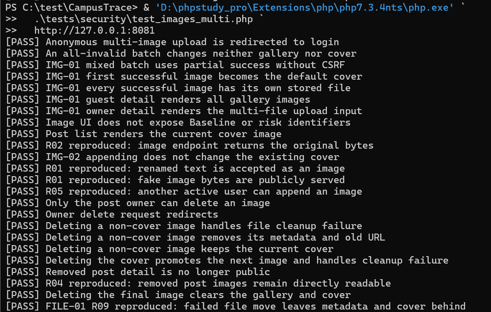

# 成员 3 多图片测试结果 / Member 3 Multi-image Test Results

## 结果摘要 / Result Summary

- 测试日期 / Test date: 2026-11-16
- 分支 / Branch: `feature/images`
- 环境 / Environment: PHPStudy PHP 7.3.4, MySQL 3307, CampusTrace 8081
- 测试方式 / Test type: 端到端 HTTP、数据库和文件系统自动测试 / End-to-end HTTP, database and filesystem automation
- 结果 / Result: **24/24 PASS**
- 功能与界面完整性 / Functional and UI completeness: **18/18 PASS**
- 漏洞复现 / Vulnerability reproduction: **7/7 reproduced for R01, R02, R04, R05, R08 and R09**

PASS 在不同类别中的含义不同 / PASS has different meanings by category:

- 功能测试 PASS：要求的正常业务行为已经完成 / PASS means the required functional behavior is complete.
- 漏洞测试 PASS：Baseline 的预期漏洞行为已经成功复现 / PASS means the expected vulnerable Baseline behavior was reproduced.
- 漏洞测试 PASS **不表示漏洞已修复** / PASS on a vulnerability test **does not mean the vulnerability was fixed**.

## 测试命令 / Test Command

```powershell
& 'D:\phpstudy_pro\Extensions\php\php7.3.4nts\php.exe' `
  .\tests\security\test_images_multi.php `
  http://127.0.0.1:8081
```

## 测试截图 / Test Evidence



## 中英对照结果 / Bilingual Results

| # | 验证类型 / Verification type | 自动化输出 / Automated output | 中文说明 / Chinese description | 结果 / Result |
| --- | --- | --- | --- | --- |
| 1 | 功能完整性 / Functional | Anonymous multi-image upload is redirected to login | 匿名用户进行多图片上传时跳转到登录页 | 功能 PASS |
| 2 | 功能完整性 / Functional | An all-invalid batch changes neither gallery nor cover | 整批文件均不合格时，不改变相册和封面 | 功能 PASS |
| 3 | 功能 + R08 复现 / Functional + R08 | IMG-01 mixed batch uses partial success without CSRF | 混合批次部分成功，同时在缺少 CSRF 时仍接受写入 | 功能 PASS，R08 已复现 |
| 4 | 功能完整性 / Functional | IMG-01 first successful image becomes the default cover | 首次上传的第一张成功图片成为默认封面 | 功能 PASS |
| 5 | 功能完整性 / Functional | IMG-01 every successful image has its own stored file | 每张成功图片均具有独立存储文件 | 功能 PASS |
| 6 | 功能完整性 / Functional | IMG-01 guest detail renders all gallery images | 访客详情页展示全部相册图片 | 功能 PASS |
| 7 | 功能完整性 / Functional | IMG-01 owner detail renders the multi-file upload input | 发布者详情页展示多文件上传控件 | 功能 PASS |
| 8 | 界面合规 / UI compliance | Image UI does not expose Baseline or risk identifiers | 图片界面不向用户暴露 Baseline 或风险编号 | 界面 PASS |
| 9 | 功能完整性 / Functional | Post list renders the current cover image | 帖子列表展示当前封面图片 | 功能 PASS |
| 10 | 漏洞复现 / Vulnerability R02 | R02 reproduced: image endpoint returns the original bytes | 图片接口返回原始字节，R02 缺口已复现 | 漏洞已复现 |
| 11 | 功能完整性 / Functional | IMG-02 appending does not change the existing cover | 追加图片不改变已有封面 | 功能 PASS |
| 12 | 漏洞复现 / Vulnerability R01 | R01 reproduced: renamed text is accepted as an image | 文本改名为图片后被接收，R01 缺口已复现 | 漏洞已复现 |
| 13 | 漏洞复现 / Vulnerability R01 | R01 reproduced: fake image bytes are publicly served | 伪装图片字节被公开返回，R01 缺口已复现 | 漏洞已复现 |
| 14 | 漏洞复现 / Vulnerability R05 | R05 reproduced: another active user can append an image | 其他激活用户可追加图片，R05 缺口已复现 | 漏洞已复现 |
| 15 | 功能完整性 / Functional | Only the post owner can delete an image | 只有帖子发布者可以删除图片 | 功能 PASS |
| 16 | 功能完整性 / Functional | Owner delete request redirects | 发布者删除请求完成并跳转 | 功能 PASS |
| 17 | 功能完整性 / Functional | Deleting a non-cover image handles file cleanup failure | 删除非封面图片时处理物理文件清理失败 | 功能 PASS |
| 18 | 功能完整性 / Functional | Deleting a non-cover image removes its metadata and old URL | 删除非封面图片后移除元数据并使旧地址失效 | 功能 PASS |
| 19 | 功能完整性 / Functional | Deleting a non-cover image keeps the current cover | 删除非封面图片后保持当前封面 | 功能 PASS |
| 20 | 功能完整性 / Functional | Deleting the cover promotes the next image and handles cleanup failure | 删除封面后下一张自动接替，并处理清理失败 | 功能 PASS |
| 21 | 功能完整性 / Functional | Removed post detail is no longer public | 下架帖子详情不再公开 | 功能 PASS |
| 22 | 漏洞复现 / Vulnerability R04 | R04 reproduced: removed post images remain directly readable | 下架帖子图片仍可直接读取，R04 缺口已复现 | 漏洞已复现 |
| 23 | 功能完整性 / Functional | Deleting the final image clears the gallery and cover | 删除最后一张图片后清空相册和封面 | 功能 PASS |
| 24 | 漏洞复现 / Vulnerability R09 | FILE-01 R09 reproduced: failed file move leaves metadata and cover behind | 文件移动失败后残留元数据或错误封面，R09 缺口已复现 | 漏洞已复现 |

## 覆盖范围 / Coverage

本次测试覆盖 / This test run covers:

- 多文件上传与部分成功 / Multi-file upload and partial success
- 封面和相册展示 / Cover and gallery rendering
- 图片追加与删除 / Image append and deletion
- 数据库、图片文件和 HTTP 响应一致性 / Database, stored file and HTTP response consistency
- R01、R02、R04、R05、R08、R09 Baseline 行为 / Baseline behavior for R01, R02, R04, R05, R08 and R09
- 删除后的旧地址失效 / Old URL invalidation after deletion
- 下架帖子图片仍可访问 / Removed-post image access remains available

## 手工测试图片 / Manual Test Images

自动化脚本会在 `tests/.tmp/` 中生成测试图片并在结束后清理，因此手工测试应另外准备自制图片。

建议保存到：

```text
C:\test\CampusTrace\tests\.tmp\manual-images
```

可以使用：

- 使用 Windows 画图新建一张纯色图，分别另存为 `manual-valid.png` 和 `manual-valid.jpg`。
- 使用记事本写入普通文本，保存为 `manual-fake.png`，用于复现 R01。
- 使用记事本创建 `manual-invalid.txt`，用于验证扩展名拒绝。
- 使用自己制作的简单图标或图形，避免真实照片、联系方式或敏感元数据。

该目录已被 Git 忽略，手工测试图片不会提交到仓库。

已提交、可直接交给测试人员使用的手工图片和完整步骤见
[手工测试图片目录](../../../tests/fixtures/images/manual/README.md)。
